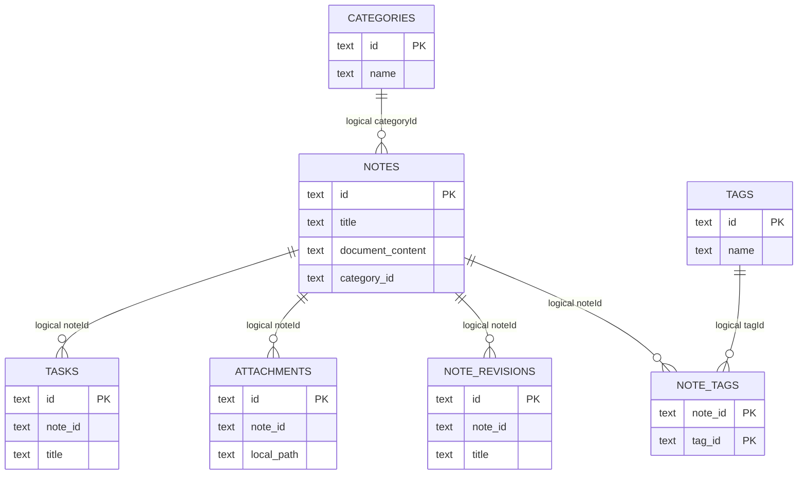

# Database Relationships

## Implemented physical tables (schema v6)

**Important:** The current Drift table definitions use primary keys but do not declare SQL foreign-key constraints for these references. The diagram's relationships are application-level logical references, not guaranteed database-enforced foreign keys. Current cleanup behavior is implemented in application operations and must be tested.

## Target relationship decisions

- Notes optionally belong to one notebook and one folder; folders may have a parent folder.
- Notes have many tags through NoteTags.
- Notes have many blocks, attachments, revisions and outgoing/incoming links.
- Tasks may link to one source note and one project; tasks may have subtasks and reminders.
- Projects contain notes, tasks and boards.
- Boards contain elements; elements connect through CanvasConnections.
- AI conversations have references to source notes.
- Sync operations may produce conflicts; deletion tombstones retain stable original IDs.
- Habits have dated entries; goals may reference projects/tasks.

## Integrity and migration policy

Before adding constraints, audit existing orphan references and create a recoverable backup. Add indexes for every foreign key and common filter. Use transactions for multi-row changes. Prefer RESTRICT or explicit application-managed cleanup for user-owned content; do not cascade-delete attachment bytes while another reference exists. Migrations must be tested from every supported prior schema version using fixture databases. Do not change the existing schema in this documentation-only step.